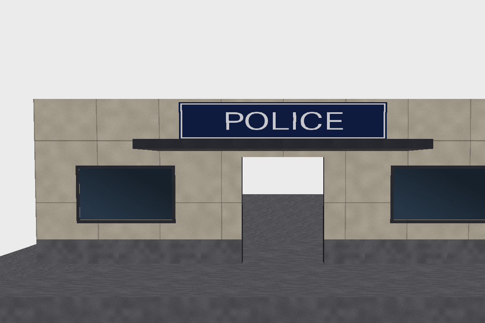
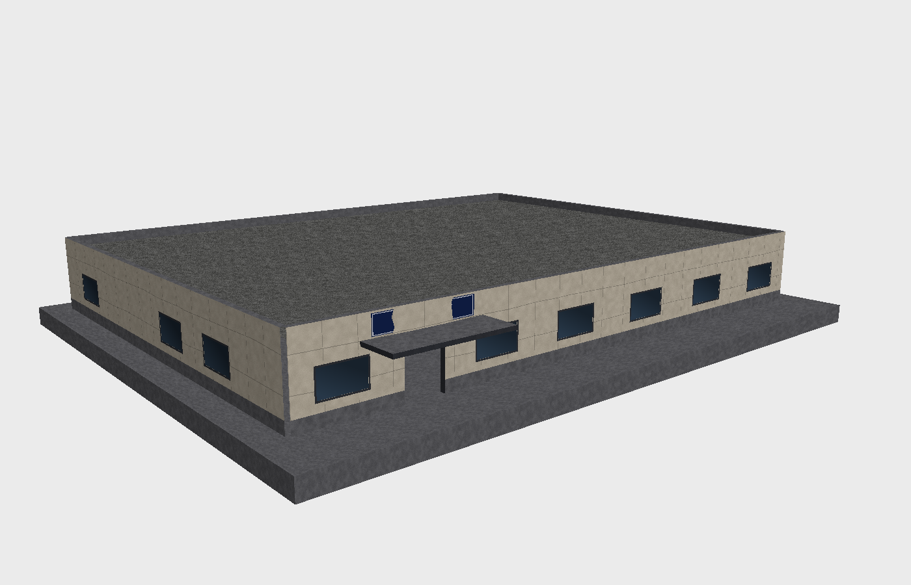
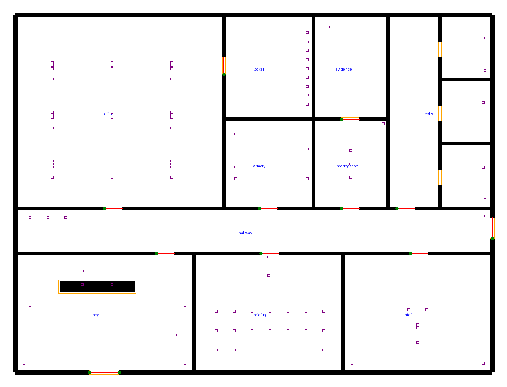

# xenon_mlo-police: policejní stanice (FiveM MLO)

Přízemní policejní stanice s interiérem (MLO) od **XenonD3VS**.




## Dispozice (32 × 24 m)



| # | Místnost | Popis |
|---|----------|-------|
| 1 | `lobby` | vstupní hala, recepční pult, čekárna |
| 2 | `hallway` | hlavní chodba, automaty na kávu a jídlo, zadní vchod |
| 3 | `briefing` | briefingová místnost, TV a 21 židlí |
| 4 | `chief` | kancelář velitele (dřevěná podlaha) |
| 5 | `office` | open-space kancelář, 9 pracovních stolů |
| 6 | `armory` | zbrojnice (stojany na zbraně, bedny s municí) |
| 7 | `locker` | šatna se skříňkami (vstup z kanceláře) |
| 8 | `interrogation` | výslechová místnost s kamerou |
| 9 | `evidence` | sklad důkazů (vstup z výslechovky) |
| 10 | `cells` | chodba se 3 celami (mříže, záchod, lavice) |

Každá místnost má vlastní model (`xenon_police_<místnost>.ydr`), vlastní světla, portály
mezi místnostmi a kolize s `RoomID`, takže hra správně pozná, ve které místnosti hráč stojí.
Exteriér (`xenon_police_ext.ydr`) obsahuje fasádu, okna, střechu s atikou, chodník, stříšku
a ceduli **POLICE** nad vchodem. Dveře, nábytek a vybavení jsou originální GTA V modely, takže
se nic dalšího nestreamuje.

## Struktura

```
xenon_mlo-police/
├── fxmanifest.lua
├── stream/             <- sem patří binární soubory (.ydr .ybn .ytyp .ymap) po sestavení
├── source/
│   ├── generate.py     <- procedurální generátor (rozložení, materiály, props, pozice)
│   └── xml/            <- vygenerované CodeWalker XML + DDS textury
├── tools/cwconv/       <- převodník XML -> binární soubory (postavený na CodeWalker.Core)
├── build.sh / build.bat
└── docs/               <- náhledy
```

## Sestavení

FiveM neumí načíst XML přímo, proto je potřeba XML jednou převést na binární soubory.

### Varianta A: automaticky (doporučeno)
Potřebuješ Python 3 (`pip install numpy pillow`), git a .NET SDK 8.

```bash
./build.sh        # Linux / macOS
build.bat         # Windows
```

Skript vygeneruje XML, stáhne a zkompiluje CodeWalker.Core a převede vše do složky `stream/`.

### Varianta B: ručně v CodeWalkeru
1. Otevři CodeWalker, **RPF Explorer**, zapni *Edit mode*.
2. Otevři libovolné RPF v `mods/` (nebo si ho vytvoř), klikni pravým, **Import XML** a vyber všechny
   soubory `*.xml` ze `source/xml` (DDS textury musí ležet ve stejné složce).
3. Importované soubory vyexportuj (*Export → Export raw*) do `stream/`.

## Instalace na server

1. Zkopíruj složku `xenon_mlo-police` do `resources/`.
2. Do `server.cfg` přidej:
   ```
   ensure xenon_mlo-police
   ```

## Umístění a úpravy

Výchozí pozice je **testovací**: rovná plocha na letišti LSIA `(-1620.0, -2780.0, 13.95)`.
Pro jiné místo uprav `CONFIG` na začátku `source/generate.py`:

```python
CONFIG = {
    "position": (x, y, z),   # jihozápadní roh podlahy
    "heading": 0.0,          # natočení ve stupních
}
```

a spusť znovu `build.sh` / `build.bat`. Případně můžeš ymap posunout přímo v CodeWalkeru
(Project → otevři `xenon_police.ymap` → posuň obě entity stejně).

V generátoru můžeš měnit i rozložení místností (`ROOMS`, `WALLS`, `PORTALS`), vybavení (`PROPS`),
dveře (`DOORS`) a textury (`TEXTURES`).

## Známá omezení

- Projekt **zatím nebyl otestován ve hře**. Geometrie i XML jsou ověřené proti zdrojovému kódu
  CodeWalkeru, ale finální kontrola ve hře zatím chybí.
- Pozice dveří a některých props (otočení monitorů, závěsy dveří) můžou potřebovat drobné doladění
  v CodeWalkeru, protože se počítají z předpokládaných rozměrů originálních GTA modelů.
- Okna jsou jen dekorativní (zvenku). Zevnitř se ven vidí jen otevřenými dveřmi.
- Textury jsou procedurální (bez normal map), aby šel celý projekt vygenerovat skriptem.

## Licence

© XenonD3VS: pouze pro osobní použití nebo použití na serveru. Další šíření ani prodej nejsou povoleny.
