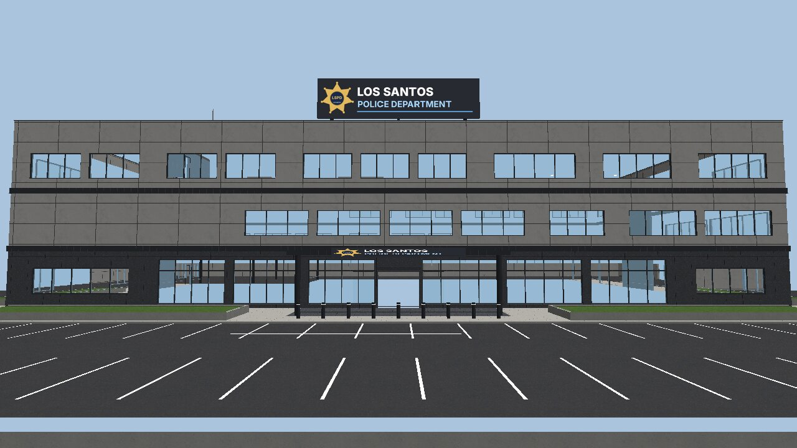
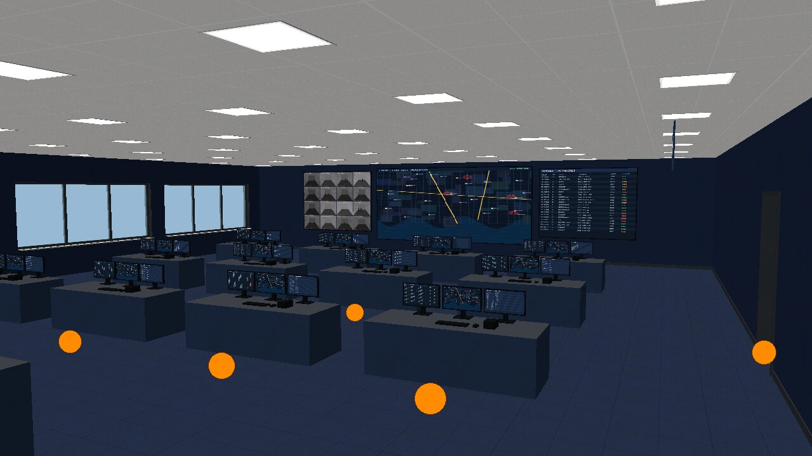
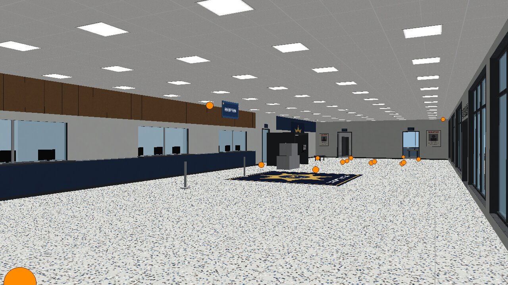
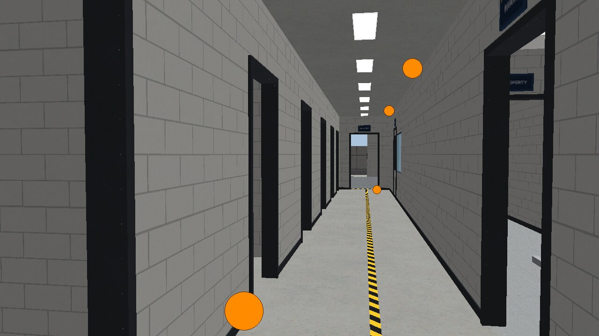

# xenon_police – Los Santos Police Department (LSPD) MLO

**Autor:** XenonD3VS  **Verze:** 1.0.0  **Typ:** FiveM MLO (interiér + exteriér + areál)

Moderní třípodlažní policejní komplex LSPD: veřejná hala s recepcí, dispečink, vyšetřovací oddělení, cely,
zbrojnice, kanceláře velení, šatny, posilovna, garáž a heliport na střeše. Celkem 80 místností na ~6 650 m².



---

## Instalace (drag & drop)

1. Zkopíruj složku `xenon_police` do `resources/` na serveru (např. `resources/[maps]/xenon_police`).
2. Do `server.cfg` přidej:
   ```
   ensure xenon_police
   ```
3. Restartuj server. Stanice je na výchozím místě (viz níže). Na mapě je blip **LSPD**.

## Požadavky

- FiveM server (artefakty z roku 2023 a novější), `fx_version 'cerulean'`.
- Nevyžaduje žádný framework (ESX / QBCore / ox), žádné DLC ani konkrétní gamebuild.
  Všechny použité vanilla modely jsou ze základní hry.
- Volitelně: doorlock skript (ox_doorlock, qb-doorlock…) – souřadnice dveří jsou v [`docs/doors.md`](docs/doors.md).

## Umístění a konfigurace

| Položka | Hodnota |
|---|---|
| Výchozí místo | Elysian Island (Signal St), přístav Los Santos |
| Počátek budovy (roh JZ, podlaha 1.NP) | `X 262.0, Y -2340.0, Z 9.55` |
| Hlavní vchod (jižní fasáda) | `X 290.0, Y -2343.0, Z 9.55` |
| Areál vč. parkovišť | `X 246 … 334`, `Y -2366 … -2274` |

Místo jsem vybral analýzou silničních uzlů a pozic objektů z datových dumpů hry jako rovnou plochu bez silnic.
**Ve hře jsem ho ověřit nemohl** (viz Známé limity). Pokud tam něco koliduje, stanici přesuneš takto:

- **Přestavbou (doporučeno):** v `tools/generator/config.json` změň `origin` na `[X, Y, Z]` (X/Y = jihozápadní
  roh budovy, Z = výška terénu + 0,35 m) a spusť build podle [`tools/README.md`](../tools/README.md).
  Přepočítají se ymapy, kolize i blip. Trvá to asi 20 s.
- **CodeWalkerem:** přesuň entity v `xenon_police.ymap` a `xenon_police_lod.ymap`. Kolize
  (`xenon_police_int_col.ybn`, `xenon_police_ext_col.ybn`) jsou ve světových souřadnicích – je nutné je posunout
  o stejný vektor, jinak kolize nesedí s modelem.

Blip vypneš v `client/blip.lua` (`ENABLE_BLIP = false`).

---

## Struktura resource

```
xenon_police/
├── fxmanifest.lua              # manifest + DLC_ITYP_REQUEST pro ytyp
├── client/blip.lua             # volitelný blip LSPD
├── stream/
│   ├── xenon_police.ytyp       # archetypy + MLO (7 místností, 72 portálů, 658 entit)
│   ├── xenon_police.ymap       # instance MLO, exteriér, areál, venkovní propy
│   ├── xenon_police_lod.ymap   # LOD budovy (do 2 km)
│   ├── xenon_police_l1/l2/l3.ydr        # interiér podlaží 1–3
│   ├── xenon_police_stair_a/_b.ydr      # schodiště A (vč. výstupu na střechu) a B
│   ├── xenon_police_garage.ydr          # garáž
│   ├── xenon_police_ext.ydr             # fasáda, střecha, heliport, nápisy
│   ├── xenon_police_ext_lod.ydr         # zjednodušený LOD model
│   ├── xenon_police_site.ydr            # parkoviště, chodníky, kryté stání, zeď dvora
│   ├── xenon_police_int_col.ybn         # kolize interiéru (s Room ID)
│   ├── xenon_police_ext_col.ybn         # kolize exteriéru a areálu
│   └── xenon_police_txd.ytd             # 134 textur (DXT1/DXT5, mipmapy)
└── docs/
    ├── plans/      # půdorysy pater se zónami
    ├── preview/    # náhledy geometrie (software render)
    └── doors.md    # seznam všech 80 dveří (model, pozice, heading)
```

FiveM streamuje jen soubory ve `stream/`, proto modely a textury nejsou v samostatných složkách `models/` /
`textures/`. Zdrojová data (textury, geometrie) vznikají generátorem v `tools/generator`.

## Dispozice

Bezpečnostní zóny: **veřejná** (modrá) → **zaměstnanecká** (zelená) → **zabezpečená** (oranžová),
**vyšetřovací** (fialová), **zadržovací** (červená), **technická** (šedá). Ze vstupní haly se do neveřejné části
projde jen přes bezpečnostní kontrolu (rám s detektorem + rentgen zavazadel) a zabezpečené dveře.

**1.NP – veřejnost, hlídková služba, zadržení**
- Vstup s automatickými posuvnými dveřmi, markýza s nápisem, vstupní hala (terazzo, logo LSPD, čekárna).
- Recepce a přepážky pro občany (prosklené přepážky s pultem), místnost pro podávání oznámení, pohovorová místnost, veřejné WC.
- Bezpečnostní kontrola, ostraha (CCTV stěna), velitel směny, kancelář seržantů.
- Briefingová místnost, místnost hlídkové služby (pracovní ostrůvky), zbrojnice (výdejní pult s mříží, stojany na zbraně, munice), výdej vest a vybavení, sklad zásahového vybavení, údržba výstroje.
- Zadržení: příjem zadržených (booking), fotografování (výšková stupnice), otisky prstů, kontrola osobních věcí, kontrola detence, chodba cel, 4 cely + 2 cely pro nebezpečné osoby.
- Sally port (průjezd pro eskortu), kancelář příjmu vozidel, garáž pro služební vozidla (3 vrata), kryté parkoviště.

**2.NP – operační centrum a vyšetřování**
- Dispečink: 12 operátorských pracovišť po 3 monitorech, videostěna (živá mapa jednotek, CCTV, CAD), pracoviště vedoucího.
- Kancelář vedoucího dispečinku, radiokomunikační místnost.
- 2 výslechové místnosti + pozorovatelna s jednosměrnými zrcadly, místnost pro identifikaci (lineup se stupnicí + pozorovací místnost), případová místnost.
- Místnost důkazů (příjmový pult, regály), forenzní laboratoř (laboratorní linky, digestoř, mikroskopy), analytické oddělení.
- Detektivní oddělení, kanceláře poručíka a seržanta, archiv, sklad dokumentů, serverovna, technická místnost, úklid.

**3.NP – velení a zázemí**
- Kancelář Police Chief a Deputy Chief (dřevo, sedačka, vlajka), sekretariát velení, velká konferenční místnost, zasedací místnost, kanceláře velitelů oddělení, kanceláře policistů.
- Šatny M/Ž s uzamykatelnými skříňkami, sprchy a WC, odpočinková místnost s automaty, kuchyňka, jídelna, posilovna.

**Střecha** – výstup schodištěm A, heliport, VZT jednotky, světelný nápis LOS SANTOS POLICE DEPARTMENT.

Půdorysy: [1.NP](docs/plans/plan_l1.png) · [2.NP](docs/plans/plan_l2.png) · [3.NP](docs/plans/plan_l3.png) · [střecha](docs/plans/plan_roof.png)

| Dispečink | Vstupní hala | Chodba cel |
|---|---|---|
|  |  |  |

Náhledy jsou ze softwarového rendereru generátoru (jen geometrie a textury, bez herního osvětlení).
Oranžové body označují vanilla propy (židle, rostliny, PC, posilovací stroje…), které vykreslí až hra.

## Technické údaje

| | |
|---|---|
| Trojúhelníky interiéru | ~58 000 (l1 16,4k · l2 24,3k · l3 13k · schodiště 3,2k · garáž 1k) |
| Trojúhelníky exteriéru + areálu | ~8 600 (LOD 44) |
| Světla | 251 v interiéru (bodová, rozdělená po patrech), 14 venku |
| Kolize | 17 372 trojúhelníků interiér (BVH, Room ID podle MLO místnosti), 2 088 exteriér |
| MLO | 7 místností (limbo, 1.NP, 2.NP, 3.NP, schodiště A, schodiště B, garáž), 72 portálů (65 ven) |
| Entity v MLO | 6 shell modelů, 80 dveří, 572 vanilla propů |
| Timecycle | `policestation` (vanilla stanice), garáž `int_hanger_small` |
| LOD | budova: HD do 350 m → LOD model do 2 000 m; interiér 150–300 m; propy 15–60 m |
| Textury | 134 procedurálně generovaných, 1 TXD (4,7 MB), shadery `normal_spec`, `emissive`, `glass_pv`, `spec` |

Dveře jsou vanilla modely (`v_ilev_ph_gendoor004`, `v_ilev_arm_secdoor`, `v_ilev_ph_cellgate`), takže fungují
s běžnými doorlock skripty. Propy jsou statické (nepohnou se po nárazu).

## Použité nástroje

- **Vlastní generátor** (`tools/generator`, Python 3 + NumPy + Pillow) – dispozice, geometrie, UV, kolize,
  světla, portály, rozmístění vybavení, procedurální textury.
- **CodeWalker.Core** (dexyfex/CodeWalker, commit `485d56b`) – kompilace CodeWalker XML do binárních
  souborů `.ydr / .ybn / .ytyp / .ymap / .ytd` a zpětné načtení každého souboru pro kontrolu.
- **Sollumz / szio** – referenční definice parametrů GTA V shaderů a formátu XML.
- **ImageMagick** – komprese textur do DXT1/DXT5 s mipmapami.
- Datové dumpy GTA V (DurtyFree/gta-v-data-dumps) – ověření všech 80 názvů vanilla modelů a timecyclů.

## Co bylo ověřeno

- Půdorys: žádné překrývající se místnosti, každé dveře spojují dva prostory, všech 80 místností je dosažitelných od hlavního vchodu.
- Všechny binární soubory zkompilovalo CodeWalker.Core a každý se znovu načetl a exportoval zpět do XML
  (kontrola, že struktura souborů je validní).
- Názvy všech vanilla modelů a timecyclů existují v aktuální verzi hry (v3717).
- Geometrie zkontrolovaná softwarovým renderem (náhledy v `docs/preview`).

## Známé technické limity

Buď prosím obezřetný – **projekt nebyl spuštěný ve hře**. V prostředí, kde vznikl, není GTA V ani FiveM klient.
Před nasazením na produkční server ho otestuj na testovacím serveru:

1. **Umístění** – výchozí místo není ověřené ve hře. Může kolidovat s budovou nebo kontejnery v přístavu, případně
   terén může prosvítat parkovištěm, pokud je výš než ~0,25 m nad odhadem. Řešení viz Konfigurace.
2. **Orientace a pivoty vanilla propů** – rozmístění počítá s tím, že propy mají pivot dole uprostřed a čelo
   směrem −Y (konvence Rockstaru). U jednotlivých kusů (zbraně na stojanech, posilovací stroje, ručníky,
   sušák rukou) může být nutné pootočit / posunout v CodeWalkeru.
3. **Šířky dveří** – otvory mají 1,2–1,3 m podle rozměrů dveří na Mission Row. Pokud některý model dveří
   nesedí přesně, je mezi křídlem a ostěním malá mezera.
4. **Navmesh není součástí** – NPC (AI policisté, chodci) uvnitř nenajdou cestu. Hráčů se to netýká.
5. **Bez occluderů a audio okluze** – portály nemají nastavenou audio okluzi, budova nemá box occludery.
   Výkon zajišťuje dělení na MLO místnosti a LOD; pro maximální výkon lze occludery doplnit v CodeWalkeru.
6. **Osvětlení** – světla jsou bodová bez stínů a vertex barvy nejsou zapečené (bez AO). Vzhled ve hře se
   může lišit od náhledů; intenzitu lze upravit v `tools/generator/building.py` a přestavět.
7. **Dveře nejsou navázané na portály** – zavřené dveře neskryjí místnost za nimi (vliv na výkon minimální,
   portály jsou jen mezi patry/schodišti/garáží a ven).
8. **Textury** jsou procedurální (generované kódem), ne fotoskeny. Lze je nahradit vlastními – stačí zachovat
   názvy v `xenon_police_txd.ytd` (např. v OpenIV / CodeWalkeru).
9. **Žádný exteriérový terén** – areál leží na vlastní desce se sokly do hloubky 4 m; na svažitém místě je nutné
   upravit výšku (Z) v konfiguraci.

### Doporučená kontrola po prvním spuštění

- Projdi všechna patra a ověř, že se nepropadáš (kolize) a interiér nebliká při přechodu mezi patry.
- V CodeWalkeru zkontroluj umístění propů (Project → `xenon_police.ytyp`) a případně dolaď.
- V konzoli F8 zkontroluj, že se neobjevují varování o chybějících assetech.
